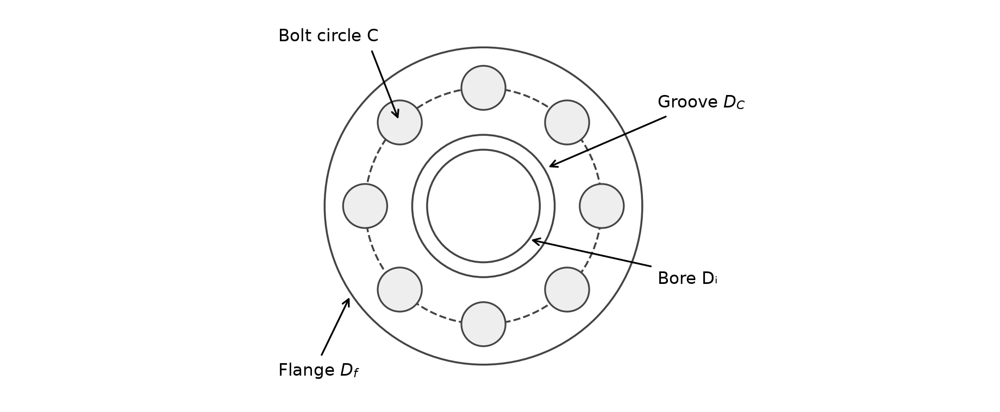
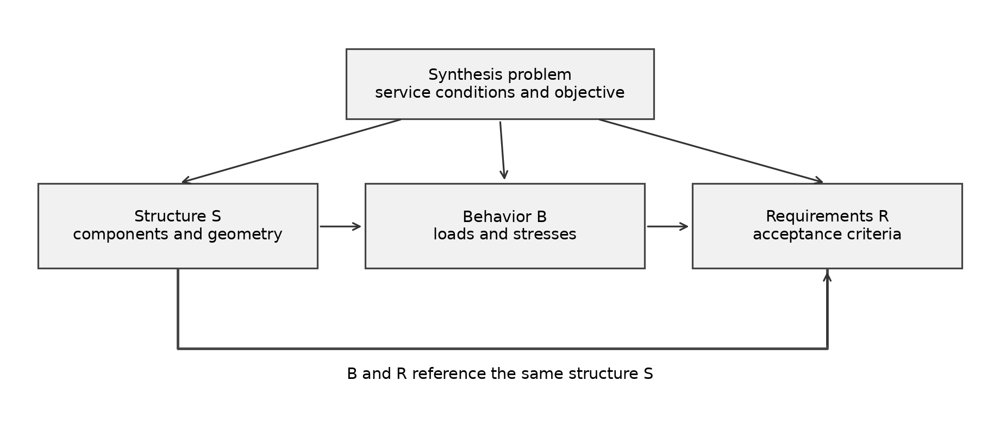
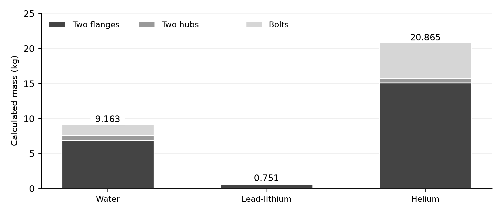
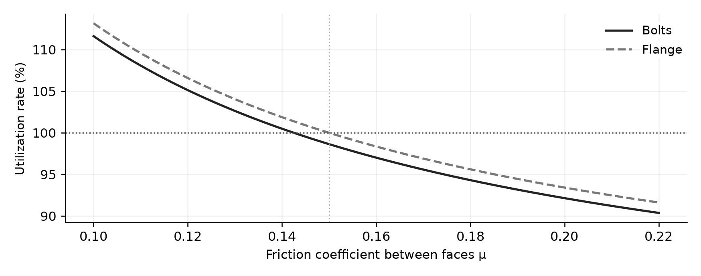

# Constraint-Based Design of Bolted Flange Assemblies for ITER

Model-Based System Synthesis (MBSS) of bolted flange connections for ITER Test Blanket Module piping, solved with **DEPS Studio**.
ISAE-Supméca, senior-year elective, 2026. [Version française](README.fr.md)

## Problem

Connect pipes carrying **water, lead-lithium (Pb-Li) and helium** with a bolted flange joint sealed by a metallic **HELICOFLEX** seal. Instead of picking a design and checking it, the problem is stated formally (variables, catalogs, equations, requirements) and the solver synthesizes configurations that satisfy every constraint while seeking a low mass.

Simultaneous decisions: seal, number and diameter of bolts, bolt and flange materials, main flange dimensions (thickness, hub, groove).

## Approach

Structure **S** (components, geometry) → Behavior **B** (loads, stresses) → Requirements **R** (acceptance criteria); B and R reference the same structure S.

- Seal: Y1, Y2, Pu with piecewise-linear temperature interpolation, pressure criterion P/Pu_θ ≤ 1, required clamping force.
- Bolts: ISO 724 thread geometry, hot properties from EN 13480-3 (E(t) law), torque and friction.
- Flange: bending ring model; hub and nut packaging constraints.
- Mass objective: two flanges + two hubs + bolts.

## Results

| Line | Calculated mass |
|---|---|
| Water | 9.163 kg (8 × M18 42CrMo4 bolts, 316LN flanges) |
| Lead-lithium | 0.751 kg |
| Helium | 20.865 kg |

Water case: bolt utilization 98.64 %, flange bending utilization 100 %. For each line, an independent recalculation confirms that the exported configuration satisfies the equations and declared requirements.

## Limitations (read these)

- The results are **feasible configurations found by the solver**; no proof of global mass optimality is claimed.
- Sensitivity to friction is significant: at μ = 0.12 the water solution becomes infeasible (critical μ ≈ 0.14 for bolts, 0.15 for the flange).
- The model is static and isothermal; flange and bolt models are simplified analytical laws (nominal stresses, no bolt-flange stiffness or load distribution among bolts).

## Repository layout

| Path | Content |
|---|---|
| `report/` | Full report (EN + FR, PDF) |
| `catalogs/` | HELICOFLEX HN200 seal catalog in SI units |
| `figures/` | Report figures |
| `deps/` | DEPS Studio models: water, lead-lithium, helium (with exported solutions) |
| `presentation/` | Defense slides |

## Team

Yassine Miftah, Adrian Ujkaj and Hossam Benkhadra. 

## References and licensing

Zaouter et al. (ITER TBM flange reference); Technetics HELICOFLEX catalog; EN 13480-3:2024; DEPS Studio documentation. Third-party standards and catalogs are cited, not redistributed. Original work is under the MIT license.
